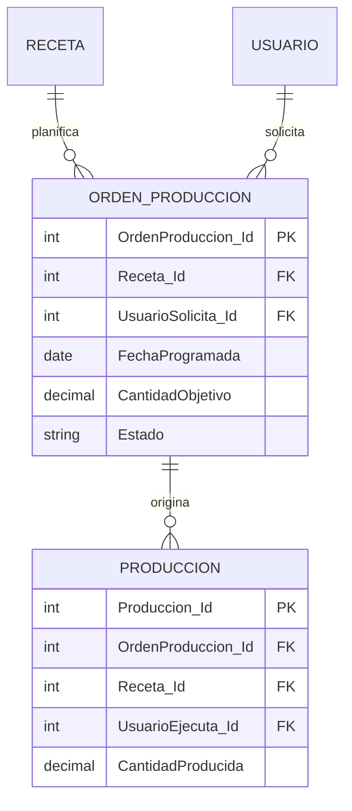

# Sistema de Base de Datos - Restaurante (Analisis Opcional)
**Propuesta alternativa no ciclica**  
**Fecha:** 2026-05-06

---

## 1. Objetivo del documento

Este documento propone una version opcional del modelo ERD orientada a:

- Reducir riesgo de ciclos de dependencia.
- Mantener trazabilidad completa de inventario y ventas.
- Permitir implementacion incremental en Laravel.

La idea central es separar claramente:

- Catalogos maestros.
- Eventos operativos (produccion, venta, merma).
- Bitacoras de movimiento.

---

## 2. Principio de diseno no ciclico

Regla base:

**Las dependencias de FK deben avanzar en un solo sentido funcional**

Direccion recomendada:

`Catalogos -> Operaciones -> Movimientos -> Reportes`

Nunca al reves.

Ejemplo correcto:

- `RECETA` es catalogo.
- `PRODUCCION` referencia `RECETA`.
- `MOV_INSUMO` y `MOV_INTERMEDIO` referencian `PRODUCCION`.

Ejemplo a evitar:

- Que `RECETA` dependa de `PRODUCCION` para existir.

---

## 3. Opcion A (simple): sin Orden de Produccion

Esta opcion es util cuando el restaurante tiene operacion pequena o mediana.

### Flujo

1. Se registra `PRODUCCION` directamente.
2. El sistema descuenta insumos (`MOV_INSUMO` SALIDA).
3. El sistema incrementa intermedios (`MOV_INTERMEDIO` ENTRADA).
4. La venta descuenta intermedios (`MOV_INTERMEDIO` SALIDA).

### Ventajas

- Menos tablas.
- Menor complejidad inicial.
- Rapida de implementar.

### Riesgos

- Menor control de planificacion.
- No separa claramente plan vs ejecucion.

---

## 4. Opcion B (control): con Orden de Produccion

Esta opcion es util cuando necesitas planificacion por turno o auditoria mas fuerte.

### Tablas nuevas

#### `ORDEN_PRODUCCION`

- `OrdenProduccion_Id` (PK)
- `Receta_Id` (FK)
- `UsuarioSolicita_Id` (FK)
- `FechaProgramada`
- `CantidadObjetivo`
- `Estado` (`PENDIENTE`, `EN_PROCESO`, `COMPLETADA`, `CANCELADA`)

#### `PRODUCCION` (ajustada)

- `Produccion_Id` (PK)
- `OrdenProduccion_Id` (FK nullable)
- `Receta_Id` (FK)
- `UsuarioEjecuta_Id` (FK)
- `CantidadProducida`
- `FechaHora`

### Ventajas

- Control de planificacion.
- Comparacion planificado vs real.
- Mejor trazabilidad de cocina.

### Costo

- Mayor complejidad funcional.
- Mas reglas de estado.

---

## 5. Modelo de tablas recomendado (no ciclico)

## 5.1 Seguridad

- `USUARIO`
- `ROL`
- `PERMISO`
- `ROL_PERMISO`

Relaciones:

- `USUARIO` -> `ROL`
- `ROL_PERMISO` -> `ROL`
- `ROL_PERMISO` -> `PERMISO`

## 5.2 Inventario crudo

- `UNIDAD_MEDIDA`
- `INSUMO`
- `INGRESO_INSUMO`
- `MERMA_INSUMO`
- `MOV_INSUMO`

Relaciones:

- `INSUMO` -> `UNIDAD_MEDIDA`
- `INGRESO_INSUMO` -> `INSUMO`, `USUARIO`
- `MERMA_INSUMO` -> `INSUMO`, `USUARIO`
- `MOV_INSUMO` -> `INSUMO` y origen operativo

## 5.3 Produccion

- `RECETA`
- `RECETA_DETALLE`
- `PRODUCTO_INTERMEDIO`
- `PRODUCCION`
- `MERMA_INTERMEDIO`
- `MOV_INTERMEDIO`
- `ORDEN_PRODUCCION` (opcional)

Relaciones clave:

- `RECETA_DETALLE` -> `RECETA`
- `RECETA_DETALLE` -> `INSUMO` **o** `PRODUCTO_INTERMEDIO` (exactamente uno)
- `PRODUCTO_INTERMEDIO` -> `RECETA` (nullable para item simple)
- `PRODUCCION` -> `RECETA`, `USUARIO` y opcionalmente `ORDEN_PRODUCCION`
- `MERMA_INTERMEDIO` -> `PRODUCTO_INTERMEDIO`, `USUARIO`
- `MOV_INTERMEDIO` -> `PRODUCTO_INTERMEDIO` y origen (`PRODUCCION` o `VENTA_DETALLE` o `MERMA_INTERMEDIO`)

## 5.4 Catalogo y ventas

- `PRODUCTO`
- `PRODUCTO_COMPONENTE`
- `CLIENTE`
- `VENTA`
- `VENTA_DETALLE`

Relaciones:

- `PRODUCTO_COMPONENTE` -> `PRODUCTO`, `PRODUCTO_INTERMEDIO`
- `VENTA` -> `CLIENTE`, `USUARIO`
- `VENTA_DETALLE` -> `VENTA`, `PRODUCTO`

---

## 6. ER grafico propuesto

### 6.1 Opcion base sin orden de produccion

```mermaid
erDiagram
   ROL ||--o{ USUARIO : tiene
   ROL ||--o{ ROL_PERMISO : asigna
   PERMISO ||--o{ ROL_PERMISO : habilita

   UNIDAD_MEDIDA ||--o{ INSUMO : mide
   INSUMO ||--o{ INGRESO_INSUMO : recibe
   INSUMO ||--o{ MERMA_INSUMO : pierde
   INSUMO ||--o{ MOV_INSUMO : mueve
   USUARIO ||--o{ INGRESO_INSUMO : registra
   USUARIO ||--o{ MERMA_INSUMO : reporta

   RECETA ||--o{ RECETA_DETALLE : define
   INSUMO ||--o{ RECETA_DETALLE : usa
   PRODUCTO_INTERMEDIO ||--o{ RECETA_DETALLE : reutiliza
   RECETA ||--o{ PRODUCTO_INTERMEDIO : produce_catalogo
   RECETA ||--o{ PRODUCCION : ejecuta
   USUARIO ||--o{ PRODUCCION : realiza
   PRODUCCION ||--o{ MOV_INSUMO : consume
   PRODUCCION ||--o{ MOV_INTERMEDIO : genera
   PRODUCTO_INTERMEDIO ||--o{ MERMA_INTERMEDIO : pierde
   PRODUCTO_INTERMEDIO ||--o{ MOV_INTERMEDIO : mueve
   USUARIO ||--o{ MERMA_INTERMEDIO : reporta
   MERMA_INTERMEDIO ||--o{ MOV_INTERMEDIO : origina

   PRODUCTO ||--o{ PRODUCTO_COMPONENTE : compone
   PRODUCTO_INTERMEDIO ||--o{ PRODUCTO_COMPONENTE : integra

   CLIENTE ||--o{ VENTA : compra
   USUARIO ||--o{ VENTA : procesa
   VENTA ||--o{ VENTA_DETALLE : contiene
   PRODUCTO ||--o{ VENTA_DETALLE : vende
   VENTA_DETALLE ||--o{ MOV_INTERMEDIO : descuenta

   ROL {
      int Rol_Id PK
      string Nombre
   }
   PERMISO {
      int Permiso_Id PK
      string Nombre
   }
   ROL_PERMISO {
      int RolPermiso_Id PK
      int Rol_Id FK
      int Permiso_Id FK
   }
   USUARIO {
      int Usuario_Id PK
      int Rol_Id FK
      string Nombre
   }
   UNIDAD_MEDIDA {
      int UnidadMedida_Id PK
      string Nombre
   }
   INSUMO {
      int Insumo_Id PK
      int UnidadMedida_Id FK
      string Nombre
      decimal StockActual
   }
   INGRESO_INSUMO {
      int Ingreso_Id PK
      int Insumo_Id FK
      int Usuario_Id FK
      decimal Cantidad
   }
   MERMA_INSUMO {
      int MermaInsumo_Id PK
      int Insumo_Id FK
      int Usuario_Id FK
      decimal Cantidad
   }
   MOV_INSUMO {
      int Movimiento_Id PK
      int Insumo_Id FK
      int Ingreso_Id FK
      int Produccion_Id FK
      int MermaInsumo_Id FK
      string Tipo
   }
   RECETA {
      int Receta_Id PK
      string Nombre
   }
   RECETA_DETALLE {
      int RecetaDetalle_Id PK
      int Receta_Id FK
      int Insumo_Id FK
      int ProductoIntermedio_Id FK
      decimal Cantidad
   }
   PRODUCTO_INTERMEDIO {
      int ProductoIntermedio_Id PK
      int Receta_Id FK
      string Nombre
      boolean EsSimple
   }
   PRODUCCION {
      int Produccion_Id PK
      int Receta_Id FK
      int UsuarioEjecuta_Id FK
      decimal CantidadProducida
   }
   MERMA_INTERMEDIO {
      int MermaIntermedio_Id PK
      int ProductoIntermedio_Id FK
      int Usuario_Id FK
      decimal Cantidad
   }
   MOV_INTERMEDIO {
      int Mov_Id PK
      int ProductoIntermedio_Id FK
      int Produccion_Id FK
      int VentaDetalle_Id FK
      int MermaIntermedio_Id FK
      string Tipo
   }
   PRODUCTO {
      int Producto_Id PK
      string Nombre
      decimal PrecioVenta
   }
   PRODUCTO_COMPONENTE {
      int ProductoComponente_Id PK
      int Producto_Id FK
      int ProductoIntermedio_Id FK
      decimal Cantidad
   }
   CLIENTE {
      int Cliente_Id PK
      string Nombre
   }
   VENTA {
      int Venta_Id PK
      int Cliente_Id FK
      int Usuario_Id FK
      decimal Total
   }
   VENTA_DETALLE {
      int VentaDetalle_Id PK
      int Venta_Id FK
      int Producto_Id FK
      int Cantidad
   }
```

### 6.2 Extension opcional con orden de produccion

---

## 7. Reglas anti-ciclo obligatorias

1. `RECETA_DETALLE`: exactamente uno entre `Insumo_Id` y `ProductoIntermedio_Id`.
2. `MOV_INSUMO`: exactamente un origen valido por registro.
3. `MOV_INTERMEDIO`: exactamente un origen valido por registro.
4. No permitir que una receta dependa de si misma (directa o indirectamente).
5. Evitar cascadas de borrado sobre historicos operativos; preferir `RESTRICT` o baja logica (`Activo = false`).

---

## 8. Reglas SQL sugeridas (CHECK logico)

Estas validaciones pueden implementarse con CHECK/trigger segun motor:

1. `RECETA_DETALLE`:
   - `(Insumo_Id IS NOT NULL AND ProductoIntermedio_Id IS NULL) OR (Insumo_Id IS NULL AND ProductoIntermedio_Id IS NOT NULL)`

2. `MOV_INSUMO`:
   - `Tipo = 'ENTRADA'` implica `Ingreso_Id` no nulo y demas origenes nulos.
   - `Tipo = 'SALIDA'` implica `Produccion_Id` o `MermaInsumo_Id` (solo uno no nulo).

3. `MOV_INTERMEDIO`:
   - `Tipo = 'ENTRADA'` implica `Produccion_Id` no nulo.
   - `Tipo = 'SALIDA'` implica `VentaDetalle_Id` o `MermaIntermedio_Id` (solo uno no nulo).

---

## 9. Recomendacion para proyecto de graduacion

Recomendacion practica:

1. Implementar primero Opcion A (sin `ORDEN_PRODUCCION`) para asegurar flujo completo.
2. Dejar `ORDEN_PRODUCCION` como extension de fase 2.
3. Documentar explicitamente que el modelo mantiene un grafo aciclico de dependencias.

Con esto tienes una arquitectura defendible academicamente y estable tecnicamente.

---

## 10. Resumen ejecutivo

- Si el objetivo es simplicidad: usa Opcion A.
- Si el objetivo es control y auditoria avanzada: usa Opcion B.
- En ambos casos, el modelo puede mantenerse no ciclico si aplicas reglas anti-ciclo en recetas y movimientos.
