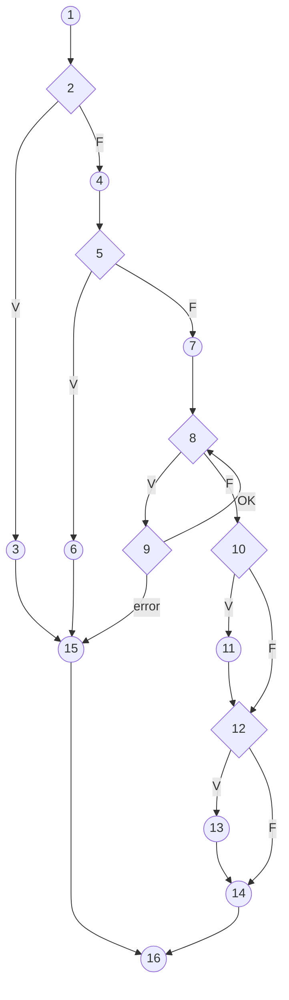

# Pruebas de Caja Blanca – Registrar Venta

**Sistema:** Producción Pollos Krosty
**Módulo:** Ventas
**Método bajo prueba:** `VentaController::store(VentaRequest $request)`
**Archivo:** `app/Http/Controllers/VentaController.php` (líneas 60–140)
**Dependencia relevante:** `StockService::moverProducto()` (`app/Services/StockService.php`)
**Técnicas aplicadas:** Cobertura de instrucciones (sentencias), cobertura de decisiones y cobertura de caminos (camino básico)

> Nota: `Api/VentaApiController::store` implementa la misma lógica dentro de `DB::transaction`, por lo que el grafo, los caminos y los casos de prueba de este documento le aplican igual (en la API los errores devuelven HTTP 422 en vez de redirigir).

---

## 1. Código fuente analizado

```php
60  public function store(VentaRequest $request): RedirectResponse
61  {
62      try {
63          DB::beginTransaction();
65          $data = $request->validated();
66          $data['fecha_venta'] = $data['fecha_venta'] ?? Carbon::now()->toDateString();
67          $data['descuento'] = $data['descuento'] ?? 0;
68          $pagoEfectivo = (float) ($data['pago_efectivo'] ?? 0);
69          $pagoQr = (float) ($data['pago_qr'] ?? 0);
70
71          if ($pagoEfectivo <= 0 && $pagoQr <= 0) {                                   // D1
72              throw new \RuntimeException('Debes registrar al menos un pago (efectivo o QR).');
73          }
75          $totalPagado = round($pagoEfectivo + $pagoQr, 2);
76          $totalVenta = round((float) $data['total'], 2);
78          if (abs($totalPagado - $totalVenta) > 0.01) {                                // D2
79              throw new \RuntimeException('La suma de pagos debe ser igual al total de la venta.');
80          }
82          $venta = Venta::create([...]);
90          $productoIds = collect($request->productos)->map(fn ($id) => (int) $id)->all();
93          foreach ($request->productos as $index => $producto_id) {                    // D3
94              $producto = Producto::with('ingredientes')->findOrFail((int) $producto_id);
96              $precioUnitario = (float) $producto->precio;
97              $cantidadVenta = (float) $request->cantidades[$index];
99              DetalleVenta::create([...]);
109             $this->stockService->moverProducto($producto, -$cantidadVenta);         // D4 (lanza excepción si no hay stock)
110         }
112         if ($pagoEfectivo > 0) {                                                     // D5
113             VentaPago::create([... 'metodo_pago' => 'Efectivo' ...]);
119         }
121         if ($pagoQr > 0) {                                                           // D6
122             VentaPago::create([... 'metodo_pago' => 'QR' ...]);
128         }
130         DB::commit();
132         return Redirect::route('ventas.index')->with('success', 'Venta creada correctamente.');
134     } catch (\Exception $e) {
135         DB::rollBack();
136         return Redirect::back()->withInput()->with('error', 'Error al crear la venta: ' . $e->getMessage());
139     }
140 }
```

Decisión interna de `StockService::moverProducto` usada en D4:

```php
if ($cantidad < 0 && (float) $fila->cantidad_actual < abs($cantidad)) {
    throw new \RuntimeException("Stock insuficiente para: {$fila->nombre}. Disponible: {$fila->cantidad_actual}");
}
```

---

## 2. Grafo de flujo

### 2.1 Nodos

| Nodo | Líneas | Descripción | Tipo |
|---|---|---|---|
| 1 | 63–69 | Inicia transacción, obtiene datos validados, asigna valores por defecto y montos de pago | Proceso |
| 2 | 71 | **D1:** `pagoEfectivo <= 0 && pagoQr <= 0` | Decisión |
| 3 | 72 | Lanza excepción "Debes registrar al menos un pago" | Proceso |
| 4 | 75–76 | Calcula `totalPagado` y `totalVenta` | Proceso |
| 5 | 78 | **D2:** `abs(totalPagado - totalVenta) > 0.01` | Decisión |
| 6 | 79 | Lanza excepción "La suma de pagos debe ser igual al total" | Proceso |
| 7 | 82–90 | Crea la `Venta` y arma la lista de ids de productos | Proceso |
| 8 | 93 | **D3:** `foreach` – ¿quedan productos por procesar? | Decisión |
| 9 | 94–109 | **D4:** Busca producto, crea `DetalleVenta` y descuenta stock – ¿se procesó sin error? | Decisión |
| 10 | 112 | **D5:** `pagoEfectivo > 0` | Decisión |
| 11 | 113–118 | Registra pago en Efectivo | Proceso |
| 12 | 121 | **D6:** `pagoQr > 0` | Decisión |
| 13 | 122–127 | Registra pago QR | Proceso |
| 14 | 130–133 | `DB::commit()` y redirección con mensaje de éxito | Proceso |
| 15 | 134–138 | `catch`: `DB::rollBack()` y redirección con mensaje de error | Proceso |
| 16 | 140 | Fin | Fin |

### 2.2 Diagrama



### 2.3 Aristas

| # | Arista | # | Arista | # | Arista |
|---|---|---|---|---|---|
| a1 | 1 → 2 | a8 | 6 → 15 | a15 | 10 → 12 |
| a2 | 2 → 3 | a9 | 7 → 8 | a16 | 11 → 12 |
| a3 | 2 → 4 | a10 | 8 → 9 | a17 | 12 → 13 |
| a4 | 3 → 15 | a11 | 8 → 10 | a18 | 12 → 14 |
| a5 | 4 → 5 | a12 | 9 → 8 | a19 | 13 → 14 |
| a6 | 5 → 6 | a13 | 9 → 15 | a20 | 14 → 16 |
| a7 | 5 → 7 | a14 | 10 → 11 | a21 | 15 → 16 |

---

## 3. Complejidad ciclomática

| Fórmula | Cálculo | Resultado |
|---|---|---|
| V(G) = A − N + 2 | 21 − 16 + 2 | **7** |
| V(G) = P + 1 (nodos predicado: 2, 5, 8, 9, 10, 12) | 6 + 1 | **7** |
| V(G) = número de regiones | 6 regiones cerradas + 1 externa | **7** |

Se necesitan como máximo **7 caminos independientes** para cubrir el método.

---

## 4. Datos de prueba (estado inicial de la BD)

| Entidad | Id | Nombre | Precio | Stock (`cantidad_actual`) |
|---|---|---|---|---|
| Cliente | 1 | Cliente Prueba | – | – |
| Producto | 1 | Pollo 1/4 | 25.00 | 10 |
| Producto | 2 | Coca-Cola 2L | 15.00 | 0 |

Todas las peticiones envían `cliente_id = 1` y datos válidos según `VentaRequest` (la validación del FormRequest se ejecuta antes de `store` y no forma parte del grafo).

---

## 5. Cobertura de caminos (camino básico)

### 5.1 Caminos independientes

| Camino | Secuencia de nodos | Descripción |
|---|---|---|
| C1 | 1 – 2 – 3 – 15 – 16 | Sin ningún pago |
| C2 | 1 – 2 – 4 – 5 – 6 – 15 – 16 | La suma de pagos no coincide con el total |
| C3 | 1 – 2 – 4 – 5 – 7 – 8 – 9 – 15 – 16 | Primer producto sin stock suficiente |
| C4 | 1 – 2 – 4 – 5 – 7 – 8 – 9 – 8 – 10 – 11 – 12 – 14 – 16 | Venta pagada solo en efectivo |
| C5 | 1 – 2 – 4 – 5 – 7 – 8 – 9 – 8 – 10 – 12 – 13 – 14 – 16 | Venta pagada solo con QR |
| C6 | 1 – 2 – 4 – 5 – 7 – 8 – 9 – 8 – 10 – 11 – 12 – 13 – 14 – 16 | Venta con pago mixto (efectivo + QR) |
| C7 | 1 – 2 – 4 – 5 – 7 – 8 – 9 – 8 – 9 – 15 – 16 | Dos productos: el 1.º tiene stock, el 2.º no (se revierte todo) |

**Camino no factible:** 1 – … – 10(F) – 12(F) – 14 (venta sin pago en efectivo ni QR que llegue al `commit`). Es imposible porque D1 ya descartó ese caso en el nodo 2 (decisiones correlacionadas). Se sustituye por C6, que es linealmente equivalente (C6 = C4 + C5 − camino no factible), por lo que el conjunto C1–C7 sigue siendo una base de 7 caminos.

### 5.2 Casos de prueba por camino

| Caso | Camino | Entrada | Resultado esperado | Resultado obtenido | Estado |
|---|---|---|---|---|---|
| CP-01 | C1 | productos=[1], cantidades=[1], total=25, pago_efectivo=0, pago_qr=0 | Redirección atrás con error *"Error al crear la venta: Debes registrar al menos un pago (efectivo o QR)."*. No se crea venta. Stock de Pollo = 10 | | |
| CP-02 | C2 | productos=[1], cantidades=[2], total=50, pago_efectivo=30, pago_qr=0 | Error *"La suma de pagos debe ser igual al total de la venta."*. No se crea venta. Stock de Pollo = 10 | | |
| CP-03 | C3 | productos=[2], cantidades=[1], total=15, pago_efectivo=15, pago_qr=0 | Error *"Stock insuficiente para: Coca-Cola 2L. Disponible: 0"*. Rollback: no existe venta ni detalle | | |
| CP-04 | C4 | productos=[1], cantidades=[2], total=50, pago_efectivo=50, pago_qr=0 | Redirección a `ventas.index` con *"Venta creada correctamente."*. 1 venta, 1 detalle (sub_total 50), 1 pago `Efectivo` = 50. Stock de Pollo = 8 | | |
| CP-05 | C5 | productos=[1], cantidades=[1], total=25, pago_efectivo=0, pago_qr=25 | Venta creada. 1 pago `QR` = 25, ningún pago en efectivo. Stock de Pollo = 9 | | |
| CP-06 | C6 | productos=[1], cantidades=[2], total=50, pago_efectivo=20, pago_qr=30 | Venta creada. 2 pagos: `Efectivo` = 20 y `QR` = 30. Stock de Pollo = 8 | | |
| CP-07 | C7 | productos=[1, 2], cantidades=[1, 1], total=40, pago_efectivo=40, pago_qr=0 | Error de stock insuficiente de Coca-Cola 2L. Rollback total: no hay venta ni detalles y el stock de Pollo vuelve a 10 | | |

---

## 6. Cobertura de decisiones

Cada decisión debe evaluarse al menos una vez como **Verdadera** y una vez como **Falsa**.

| Decisión | Línea | Condición | Verdadero (caso) | Falso (caso) |
|---|---|---|---|---|
| D1 | 71 | `pagoEfectivo <= 0 && pagoQr <= 0` | CP-01 | CP-02 … CP-07 |
| D2 | 78 | `abs(totalPagado - totalVenta) > 0.01` | CP-02 | CP-03 … CP-07 |
| D3 | 93 | ¿Quedan productos en el `foreach`? | CP-03 … CP-07 | CP-04, CP-05, CP-06 (sale del bucle) |
| D4 | 109 | ¿Producto procesado sin error (hay stock)? | CP-04, CP-05, CP-06, CP-07 (1.er producto) | CP-03, CP-07 (2.º producto) |
| D5 | 112 | `pagoEfectivo > 0` | CP-04, CP-06 | CP-05 |
| D6 | 121 | `pagoQr > 0` | CP-05, CP-06 | CP-04 |

**Conjunto mínimo para 100 % de cobertura de decisiones:** CP-01, CP-02, CP-03, CP-04, CP-05 (12/12 salidas cubiertas).

### 6.1 Cobertura de condiciones de D1 (decisión compuesta)

| `pagoEfectivo <= 0` | `pagoQr <= 0` | Resultado D1 | Caso |
|---|---|---|---|
| V | V | V | CP-01 |
| V | F | F | CP-05 |
| F | V | F | CP-04 |
| F | F | F | CP-06 |

---

## 7. Cobertura de instrucciones (sentencias)

Cada instrucción del método debe ejecutarse al menos una vez.

| Bloque (nodo) | Líneas | CP-01 | CP-02 | CP-06 |
|---|---|:---:|:---:|:---:|
| 1 – Inicio y asignaciones | 63–69 | ✔ | ✔ | ✔ |
| 3 – Excepción "sin pago" | 72 | ✔ | | |
| 4 – Cálculo de totales | 75–76 | | ✔ | ✔ |
| 6 – Excepción "suma de pagos" | 79 | | ✔ | |
| 7 – Crear venta | 82–90 | | | ✔ |
| 9 – Detalle y descuento de stock | 94–109 | | | ✔ |
| 11 – Pago en efectivo | 113–118 | | | ✔ |
| 13 – Pago QR | 122–127 | | | ✔ |
| 14 – Commit y éxito | 130–133 | | | ✔ |
| 15 – Rollback y error | 135–138 | ✔ | ✔ | |

**Conjunto mínimo para 100 % de cobertura de instrucciones:** CP-01, CP-02, CP-06.

---

## 8. Resumen

| Técnica | Elementos a cubrir | Casos mínimos | Cobertura |
|---|---|---|---|
| Cobertura de instrucciones | 10 bloques de sentencias | CP-01, CP-02, CP-06 | 100 % |
| Cobertura de decisiones | 6 decisiones × 2 salidas = 12 | CP-01 … CP-05 | 100 % |
| Cobertura de caminos | V(G) = 7 caminos independientes | CP-01 … CP-07 | 100 % (7/7) |

**Observaciones**

- El bloque `try/catch` con `DB::rollBack()` garantiza que, ante cualquier error (CP-01, CP-02, CP-03, CP-07), no quede una venta parcial ni stock descontado.
- La línea 90 (`$productoIds = ...`) se ejecuta pero su resultado no se usa en el método: es código muerto que podría eliminarse.
- Las validaciones de formato (cliente existente, `productos` con al menos un elemento, cantidades ≥ 0.01, etc.) las realiza `VentaRequest` antes de ejecutar `store`, por eso el caso "lista de productos vacía" no es alcanzable dentro del método.
